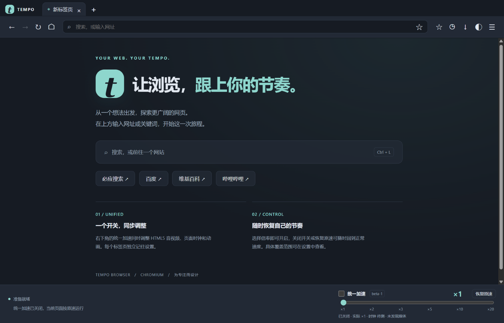

<div align="center">


# TempoBrowser

**基于 Chromium 的 Windows 桌面浏览器，统一调整媒体播放、动画和页面计时速度。**

中文界面 · 多标签页 · 独立倍率 · 浅色 / 深色主题

[](https://github.com/DrLogicBox/TempoBrowser/releases/tag/v1.0.0-beta.1)


[](LICENSE)

[下载 beta-1](https://github.com/DrLogicBox/TempoBrowser/releases/tag/v1.0.0-beta.1) · [功能与用法](#功能与用法) · [实测结果](docs/verification.md) · [开发指南](docs/development.md)



</div>

## 它能做什么

TempoBrowser 提供基本桌面浏览功能，并把 HTML5 音视频播放速度、页面脚本时钟和网页动画接到同一个加速设置。可以用它浏览网页、调整媒体播放速度，以及在自己的本地页面上观察计时与上报数据的变化。

beta-1 使用 Chromium / Electron 成熟内核，将原先分别控制的媒体加速和网页时间加速合并，保留每个标签页的独立配置及实际效果反馈。

| 能力 | beta-1 行为 |
| --- | --- |
| 统一加速 | 一个开关控制媒体、已支持的页面时钟和动画 |
| 六挡倍率 | ×1、×2、×3、×5、×10、×20，分别显示所选倍率与实际反馈 |
| 标签独立 | 新建、关闭、切换标签，刷新和跳转后沿用当前标签的加速设置 |
| 基础浏览 | 地址与关键词搜索、前进、后退、刷新、停止、加载及访问失败提示 |
| 常用数据 | 书签、历史、下载进度、持久登录状态和浏览数据清理 |
| 中文界面 | 浅色与深色主题，右下角固定加速区，支持窗口缩放 |

## 下载与启动

前往 [beta-1 Release](https://github.com/DrLogicBox/TempoBrowser/releases/tag/v1.0.0-beta.1)，下载 `TempoBrowser-beta-1-win-x64.zip`，完整解压后双击 `TempoBrowser.exe`。

便携程序已包含运行时，用户无需另装 Node.js、Chrome 或 WebView2。保留完整文件夹即可运行。用户数据位于程序旁的 `user-data`，下载位于 `Downloads`。

目标系统为 Windows 10/11 x64，本次实测覆盖当前 Windows 主机。程序尚未代码签名，其他系统构建版本及全新系统环境列为未验证。Release 同时提供源码压缩包与 SHA256 校验文件。

## 功能与用法

1. 在地址栏输入网址或关键词，打开网页。
2. 在右下角选择倍率，统一加速会自动开启。
3. 查看页面时钟观测值、媒体 API 实际倍率及播放进度反馈。
4. 关闭开关会回到原速并保留所选倍率，重新开启可继续使用该倍率。
5. 点击“恢复原速”会关闭加速并将选择值设为 ×1。

启用加速直接生效。每个标签页独立记录开关和倍率，新标签页默认关闭。

## 已验证的效果

beta-1 已实际启动并完成六挡同时测量、35 项统一加速与基础界面检查、15 轮前后端计时回归，以及 6 轮媒体播放与上报同页测试。

以下为 ×2 计时回归各三轮的平均值，单位为秒。页面通过普通计时接口计算累计时长，再经正常请求上报。

| 后台采用规则 | 现实经过 | 页面累计 | 请求上报 | 后台最终采用 | 服务端独立计时 |
| --- | ---: | ---: | ---: | ---: | ---: |
| 前端累计时长 | 10.0022 | 20.0050 | 20.0050 | 20.0050 | 10.0020 |
| 服务端自身时钟 | 10.0061 | 20.0126 | 20.0126 | 10.0061 | 10.0061 |

采用前端累计值的本地后台记录并采用了约 20 秒。采用服务端自身时钟的后台最终采用约 10 秒。三轮运行中切换的累计值约为 14 秒，采样保持连续单调。

完整逐挡结果、误差、后台规则及复现方式见[验证报告](docs/verification.md)。

## 加速覆盖范围

| 机制 | 支持范围 |
| --- | --- |
| HTML5 `video` / `audio` | 设置播放倍率，观察新增元素、播放器替换和页面重设倍率 |
| `Date` / `performance.now()` | 连续虚拟时钟，切换倍率时保留已累计时间 |
| 函数型 `setTimeout` / `setInterval` | 按虚拟剩余时间调度，受事件循环与后台调度影响 |
| CSS / Web Animations | 调整动画播放倍率，新动画有巡检延迟 |
| `requestAnimationFrame` | 调整时间戳，帧率仍受显示器与事件循环限制 |
| 嵌入框架 | 同源与本地跨域样本已验证，覆盖取决于注入是否成功 |

**媒体 ×20 存在已确认的内核限制。** Chromium 拒绝该播放倍率，工具区会显示“部分生效”和媒体实际值。页面时钟和已支持的动画仍可接近 ×20，已有媒体可能保留此前接受的倍率，新媒体可能维持原速。高倍率有丢帧、缓冲、静音或音质异常风险。

Worker / ServiceWorker、自定义 WebAudio、封闭 Shadow DOM、DRM 与主动反篡改脚本存在覆盖边界。服务器时间、网络及下载带宽由各自机制决定。时间变化还可能影响页面超时和时间戳校验。第三方业务流程、隐藏页面、断网重试、`sendBeacon`、签名校验、高倍速声音听感及跨系统环境均未验证。

账号同步、扩展商店、密码库、自动更新、隐私窗口和完整站点权限管理尚未提供。

## 开发与测试

推荐 Windows x64、Node.js 22.12+ 或 24 LTS。下载仓库后，可以复用 Release 的完整运行目录，或使用构建脚本准备 Electron 运行时。

```powershell
npm ci
npm run build
npm start
```

```powershell
npm test
npm run test:time
node tests/combined-report.cjs
```

测试会实际打开窗口，并把配置、缓存和日志保存在当前项目目录。运行时准备、打包、目录结构与原始日志说明见[开发指南](docs/development.md)。

## 许可

应用源码与项目标识采用 [MIT License](LICENSE)。Electron、Chromium 及其捆绑组件保留各自许可证，随便携程序提供。
